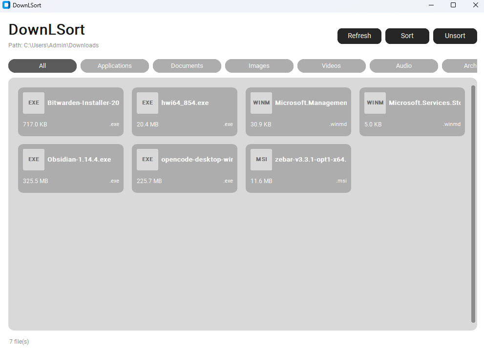

# DownLSort

A clean, modern Python desktop app that organizes a cluttered Downloads
folder. Files are grouped by type into subfolders, with a live preview,
one-click sorting, and an **Unsort** feature that restores every file to
its exact original location.



## Features

- **Sort by category** — moves top-level files into subfolders:
  `Applications`, `Documents`, `Images`, `Videos`, `Audio`, `Archives`,
  `Other` (extension-based, case-insensitive, compound extensions like
  `.tar.gz` handled).
- **Live preview** — the file grid shows everything before you sort;
  a confirmation dialog summarizes the plan ("Move 42 files into
  5 folders?").
- **Unsort** — reverses the last sort exactly, using a persistent JSON
  movement log. Repeat presses walk back through older sessions.
- **Category filter chips** — filter the grid without moving anything.
- **Safe by design** — never overwrites: conflicts become
  `file (1).pdf`. One bad file (in use, permission denied) is reported
  while the rest continue. Sorting runs in a background thread so the UI
  never freezes.
- **Custom folder** — click the `Path:` label to organize any folder,
  or pass `--path`.

## Install

Requires Python 3.10+.

```bash
pip install -e .
```

For development (includes pytest):

```bash
pip install -e ".[dev]"
```

## Usage

```bash
downlsort                 # organize ~/Downloads
downlsort --path D:\Temp  # organize another folder
python -m downlsort --path D:\Temp   # without installing
```

| Button   | What it does                                          |
|----------|-------------------------------------------------------|
| Refresh  | Re-scan the folder and update the grid                |
| Sort     | Preview the plan, confirm, then move files by category|
| Unsort   | Move the last-sorted files back to original locations |
| `Path:` label (click) | Choose a different folder to organize |

## How Unsort works

Every Sort appends one session to a history file kept **outside** the
managed folder, so cleanup can't delete it:

- Windows: `%APPDATA%\DownLSort\history.json`
- macOS/Linux: `~/.config/downlsort/history.json`

Each session stores `original path → new path` for every moved file
(including the actual ` (1)`-renamed destinations). Unsort reverses the
most recent non-undone session, skips files that no longer exist at
their sorted location (reported, not fatal), and removes category
folders left empty.

## Categories

| Category     | Examples                                              |
|--------------|-------------------------------------------------------|
| Applications | `.exe` `.msi` `.bat` `.dmg` `.deb` `.apk`             |
| Documents    | `.pdf` `.docx` `.txt` `.md` `.xlsx` `.pptx` `.epub`   |
| Images       | `.jpg` `.png` `.gif` `.webp` `.svg` `.heic`           |
| Videos       | `.mp4` `.mkv` `.avi` `.mov` `.webm`                   |
| Audio        | `.mp3` `.wav` `.flac` `.m4a` `.opus`                  |
| Archives     | `.zip` `.rar` `.7z` `.tar.gz` `.iso`                  |
| Other        | everything else (incl. extensionless files)           |

The full table lives in `src/downlsort/categories.py` — one place to
extend.

## Project structure

```
src/downlsort/
├── __init__.py     # version
├── __main__.py     # `python -m downlsort`
├── main.py         # CLI entry point (--path, --version)
├── app.py          # main window: header, chips, grid, wiring
├── widgets.py      # FileCard + ChipBar components
├── categories.py   # extension → category table
├── scanner.py      # folder scan → FileItem list
├── organizer.py     # move planning + conflict-safe execution
└── history.py      # persistent JSON log + undo bookkeeping
tests/test_core.py  # 17 tests: mapping, scan, moves, undo round-trip
Design/image.png    # UI mockup
```

Core logic (`categories`, `scanner`, `organizer`, `history`) is
GUI-independent and fully unit-tested.

## Development

```bash
python -m pytest        # run the test suite (17 tests)
```

Tests use temporary directories only — they never touch your real
Downloads folder.
